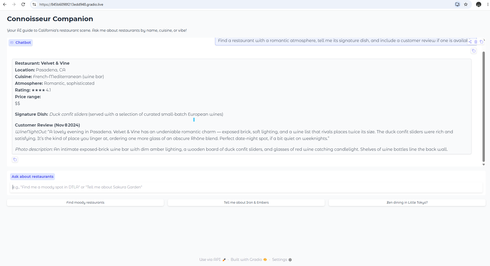
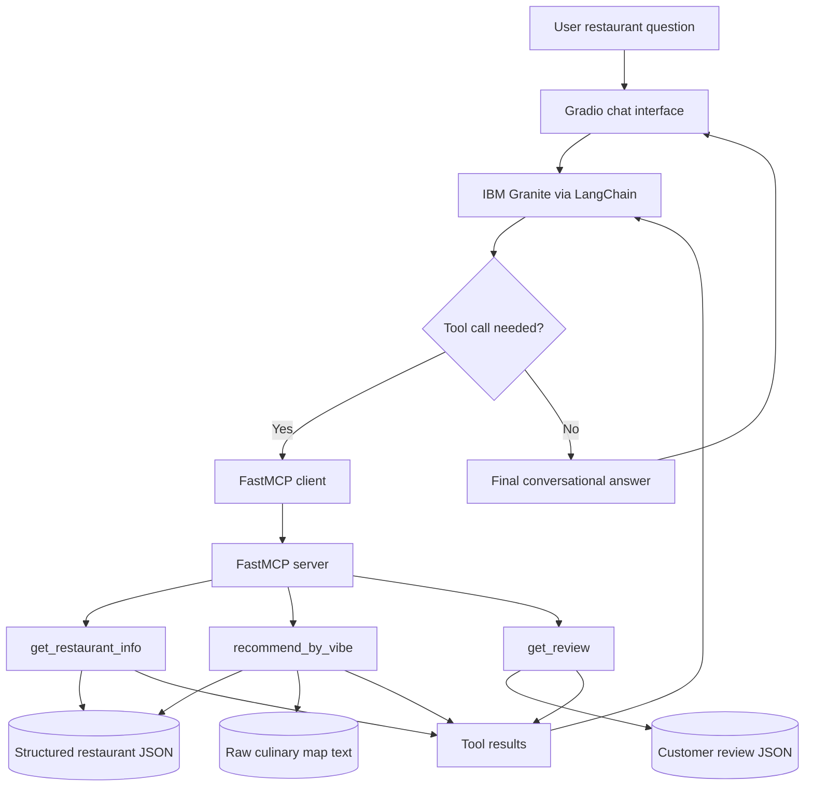
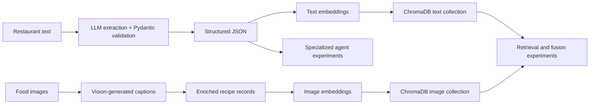
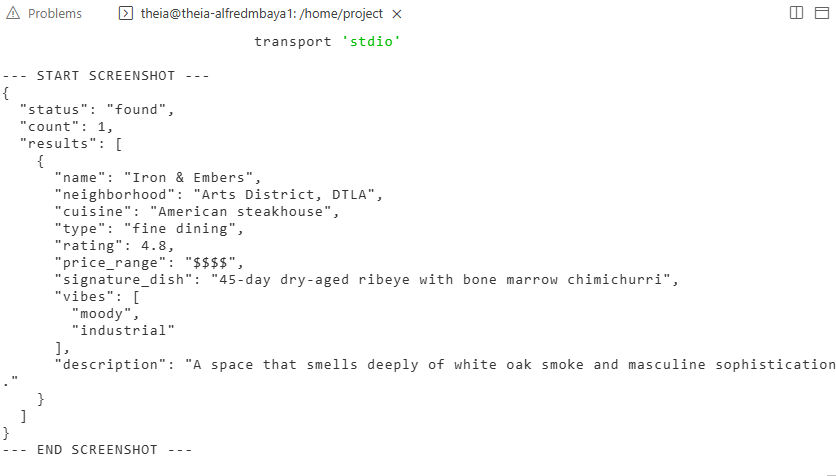
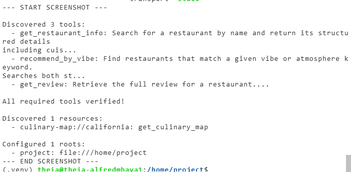
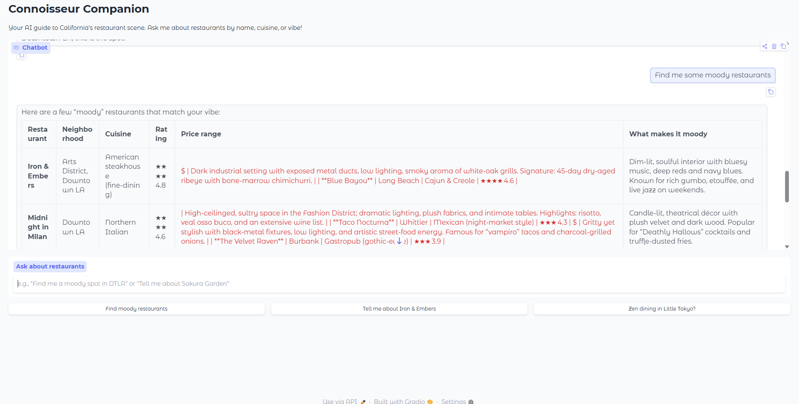

# 🍽️ Connoisseur Companion — RAG & Agentic AI Capstone

**IBM RAG and Agentic AI Capstone Project** · **Completed October 22, 2026** · **Final assessment: 60/60 (100%)**

An educational, AI-powered restaurant recommendation prototype developed through four hands-on modules: **structured LLM data extraction, multimodal RAG, multi-agent workflows, and an MCP-enabled conversational application**.

> **Project scope:** The final working interface is a Gradio chatbot backed by IBM Granite and three FastMCP tools. The multimodal ChromaDB experiments and specialized multi-agent workflows are **separate lab implementations**, not components directly called by the final chatbot. Restaurant records are course datasets, not live listings or reservation availability.



## 📑 Table of Contents

- [🎯 Project Overview](#-project-overview)
- [🏗️ Solution Architecture](#️-solution-architecture)
- [✨ Key Features](#-key-features)
- [🧩 Development Modules](#-development-modules)
- [🛠️ MCP Tools and ReAct Workflow](#️-mcp-tools-and-react-workflow)
- [⚙️ Technology Stack](#️-technology-stack)
- [📸 Project Screenshots](#-project-screenshots)
- [📂 Repository Structure](#-repository-structure)
- [🚀 Running the MCP Chatbot](#-running-the-mcp-chatbot)
- [📊 Results and Limitations](#-results-and-limitations)
- [💡 Key Learnings and Next Steps](#-key-learnings-and-next-steps)

## 🎯 Project Overview

**Connoisseur Companion** explores how unstructured culinary descriptions and food imagery can become searchable data and, ultimately, a conversational restaurant recommendation experience.

The capstone followed four technical stages:

| Module | What was implemented | Explore |
|---|---|---|
| **01 — Structured GenAI** | Restaurant-to-JSON extraction, schema validation, automatic JSON repair, image captioning, and data-entry tooling | [Module overview](01-Structured-GenAI/) · [Screenshots](screenshots/Module-1/) |
| **02 — Multimodal RAG** | Text/image embeddings, two ChromaDB collections, metadata filtering, and weighted fusion ranking | [Module overview](02-Multimodal-RAG/) · [Screenshots](screenshots/Module-2/) |
| **03 — Multi-Agent System** | Specialized recommendation agents, food-style analysis nodes, preference extraction, and chatbot tests | [Module overview](03-Multi-Agent-System/) · [Screenshots](screenshots/Module-3/) |
| **04 — MCP Application** | MCP server and client, resource/tool discovery, IBM Granite tool-calling loop, and Gradio interface | [Python source](04-MCP-Application/src/) · [Tests](04-MCP-Application/tests/) · [Screenshots](screenshots/Module-4/) |

## 🏗️ Solution Architecture

### Final MCP chatbot — implemented runtime



**Workflow:** User query → Gradio → Granite selects MCP tools → MCP server searches course data → tool results return to Granite → conversational response.

### Earlier lab capabilities — separate demonstrations



> **Architecture clarification:** These diagrams distinguish what was demonstrated across the course from what is actually connected in the final chatbot. The chatbot does **not** currently query the Module 2 ChromaDB index or run the Module 3 multi-agent workflow.

## ✨ Key Features

- 🧾 **Structured extraction:** Convert restaurant descriptions into validated, query-friendly JSON.
- 🛠️ **Automatic repair:** Retry malformed LLM output against a required schema.
- 🖼️ **Multimodal enrichment:** Caption food images and build text/image embeddings.
- 🔎 **Vector retrieval:** Search ChromaDB collections using similarity and metadata filters.
- ⚖️ **Fusion ranking:** Compare text-heavy and image-heavy retrieval weights.
- 🤖 **Specialized agents:** Experiment with food-style reasoning and preference extraction.
- 🔌 **MCP integration:** Expose restaurant information, vibe matching, and reviews as callable tools.
- 💬 **Interactive assistant:** Ask natural-language questions through a Gradio interface.

## 🧩 Development Modules

### Module 1 — Structured GenAI and multimodal enrichment

The lab used an LLM to extract attributes such as restaurant name, location, cuisine, rating, and price range from descriptive text. **Pydantic** validation and automatic repair logic helped produce consistent JSON. A vision-enabled model generated captions for recipe images; a command-line workflow supported restaurant record management.

**Evidence:** [JSON extraction loop](screenshots/Module-1/M1L1_structure_for_loop.png) · [Recipe captioning](screenshots/Module-1/M1L2_caption_all_recipes.png) · [New-entry repair process](screenshots/Module-1/M1L3_new_data_entry_process.png)

### Module 2 — Multimodal RAG

The lab constructed the `restaurant_articles` and `food_images` **ChromaDB** collections using SentenceTransformer text embeddings and CLIP image embeddings. Retrieval demonstrations included Top-K results, metadata filters, and normalized, weighted text/image fusion scores.

**Evidence:** [Vector index](screenshots/Module-2/M2L1_multimodal_vector_index.png) · [Similarity retrieval](screenshots/Module-2/M2L2_similarity_retrieval.png) · [Fusion rankings](screenshots/Module-2/M2L3_multimodal_fusion_results.png)

### Module 3 — Specialized recommendation agents

The lab configured a **Food Style Expert** with role, goal, and backstory; implemented the `node_analyze_styles()` workflow node; and tested `extract_preferences()` to interpret user requests for recommendations.

**Evidence:** [Food Style Expert](screenshots/Module-3/M3L1_food_style_expert_goal.png) · [Analysis node](screenshots/Module-3/M3L2_node_analyze_styles.png) · [Preference extraction test](screenshots/Module-3/M3L3_preference_extraction_test.png)

### Module 4 — MCP server, client, and host application

The final lab exposed restaurant data through a **FastMCP server**, verified tools/resources/roots through an MCP client, and created a **Gradio** chatbot whose **IBM Granite** model can request and execute MCP tools in a bounded ReAct-style loop.

**Source:** [`server.py`](04-MCP-Application/src/server.py) · [`client.py`](04-MCP-Application/src/client.py) · [`app.py`](04-MCP-Application/src/app.py) · [`test.py`](04-MCP-Application/tests/test.py)

## 🛠️ MCP Tools and ReAct Workflow

| Tool | Input | Purpose |
|---|---|---|
| `get_restaurant_info()` | `restaurant_name` | Search structured restaurant records by name |
| `recommend_by_vibe()` | `vibe` | Match atmosphere keywords against JSON vibe/description fields and raw culinary text |
| `get_review()` | `restaurant_name` | Retrieve an available customer review |

The MCP server also exposes the `culinary-map://california` resource. The client demonstrates tool discovery, resource discovery, configured roots, and a sampling callback.

**Important implementation detail:** `recommend_by_vibe()` performs **two passes of case-insensitive keyword matching**. Despite the lab's semantic-search wording, this specific MCP tool does **not** use vector embeddings. Vector similarity search is demonstrated separately in Module 2.

In the Gradio application, `chat_with_agent()` discovers the MCP tool schemas, binds them to the IBM Granite model, executes requested tools via `client.call_tool()`, and returns tool results to the model until it produces an answer or reaches its iteration limit.

## ⚙️ Technology Stack

| Technology | Role in the capstone |
|---|---|
| **Python / asyncio** | Data processing and asynchronous MCP communication |
| **IBM watsonx.ai / Granite** | Language model for the final chatbot |
| **LangChain** | Message types, model invocation, and tool binding |
| **FastMCP / MCP** | Tool server, client, and resource discovery |
| **Gradio** | Interactive chatbot interface |
| **Pydantic / JSON** | Structured data and validation |
| **ChromaDB** | Vector collections and retrieval experiments |
| **SentenceTransformers / CLIP** | Text and image embeddings |
| **Vision LLM** | Food-image caption generation |

## 📸 Project Screenshots

### Final application — multi-part restaurant recommendation


*The chatbot answers a multi-part question about a romantic restaurant, its signature dish, and a customer review.*

### MCP server verification

[](screenshots/Module-4/M4L1_Configure_Tools_Data_MCP_Server.png)

*`get_restaurant_info()` returns a JSON-formatted restaurant search result.*

### MCP client verification

[](screenshots/Module-4/M4L2_Build_Test_MCP_Client.png)

*The MCP client confirms three tools, a culinary map resource, and the project root.*

### Vibe-based discovery

[](screenshots/Module-4/M4L3_Vibe_Based_Search.png)

*The chatbot uses atmosphere-based matching to suggest restaurants; the example also reveals opportunities to improve output formatting.*

**Browse the full screenshot collection:** [Module 1](screenshots/Module-1/) · [Module 2](screenshots/Module-2/) · [Module 3](screenshots/Module-3/) · [Module 4](screenshots/Module-4/)

## 📂 Repository Structure

```text
Connoisseur-Companion-RAG-Agentic-AI/
├── 01-Structured-GenAI/          # Module 1 overview
├── 02-Multimodal-RAG/            # Module 2 overview
├── 03-Multi-Agent-System/        # Module 3 overview
├── 04-MCP-Application/
│   ├── src/
│   │   ├── server.py             # FastMCP tools and resource
│   │   ├── client.py             # MCP client verification and demos
│   │   └── app.py                # IBM Granite + Gradio chatbot
│   └── tests/
│       └── test.py              # MCP restaurant lookup smoke test
├── screenshots/
│   ├── Module-1/
│   ├── Module-2/
│   ├── Module-3/
│   └── Module-4/
├── data/                         # Optional permitted data artifacts
├── requirements.txt             # Dependency list (upload if missing)
├── .gitignore                    # Excludes local secrets and caches
└── README.md
```

> **Source availability:** Modules 1–3 are documented through overviews and screenshots in this repository; their original notebooks are not included in the current GitHub package. The Python source for Module 4 is included.

## 🚀 Running the MCP Chatbot

### 1. Clone the repository

```bash
git clone https://github.com/MbayaAlfred/Connoisseur-Companion-RAG-Agentic-AI.git
cd Connoisseur-Companion-RAG-Agentic-AI
```

### 2. Prepare the course data

The MCP server requires the restaurant JSON, customer-review JSON, and original `California-Culinary-Map.txt` file. **The raw culinary map is not included** in the shared package. Only use and redistribute course datasets where permitted.

Check the data paths expected by [`server.py`](04-MCP-Application/src/server.py) before running; the scripts were reorganized from the original lab directory structure.

### 3. Set up Python

Use **Python 3.11**, create a virtual environment, and install dependencies once `requirements.txt` has been uploaded:

```bash
python -m venv .venv
```

Windows:

```powershell
.venv\Scripts\activate
pip install -r requirements.txt
```

macOS/Linux:

```bash
source .venv/bin/activate
pip install -r requirements.txt
```

### 4. Configure watsonx.ai

Provide the required IBM watsonx.ai credentials and project identifier through environment variables (for example, `WATSONX_APIKEY` and `WATSONX_AI_PROJECT_ID`). **Never commit API keys or `.env` files.** The standalone MCP client also uses Anthropic for its optional sampling callback, which requires separate credentials if that path is exercised.

### 5. Test and launch

From the repository root:

```bash
python 04-MCP-Application/tests/test.py
python 04-MCP-Application/src/app.py
```

Run the client discovery/demo separately if desired:

```bash
python 04-MCP-Application/src/client.py
```

> **Reproducibility status:** The app ran successfully in the original IBM lab environment. The reorganized GitHub package has **not** been verified end-to-end with the missing raw culinary map and your watsonx.ai configuration; the commands above are a setup guide, not a claim of a turnkey deployment.

## 📊 Results and Limitations

- 🏆 **Capstone final assessment:** **60/60 (100%)**, completed October 22, 2026.
- ✅ **Demonstrated:** LLM-based JSON structuring, image captioning, vector retrieval, fusion ranking, agent workflows, MCP tools, and a functioning Gradio chatbot in the lab.
- ⚠️ **Not demonstrated as a single integrated runtime:** The final MCP chatbot does not call the Module 2 vector index or Module 3 specialized agent graph.
- ⚠️ **Data and deployment:** Restaurant information comes from course data; there is no live restaurant availability, production deployment, or permanent hosted app URL.
- ⚠️ **Potential enhancements:** Improve recommendation-table formatting, error handling, tests, source attribution, and dependency reproducibility.

## 💡 Key Learnings and Next Steps

This capstone reinforced the progression from **raw data → validated structured records → multimodal retrieval experiments → specialized agent workflows → an MCP tool-enabled conversational interface**.

Potential next steps include integrating the ChromaDB index into the final chatbot, adding evaluation datasets and automated tests, improving Gradio presentation, and deploying a secured version with properly licensed data.

---

**Project:** IBM RAG and Agentic AI Capstone · **Portfolio focus:** Generative AI · Multimodal RAG · Agentic AI · MCP · Python

**Acknowledgment:** IBM and Coursera. Educational implementation; please respect the original course materials and dataset licensing.
